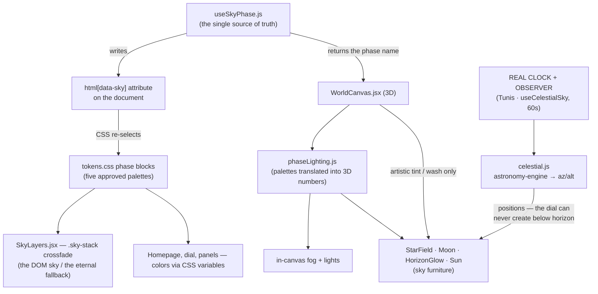
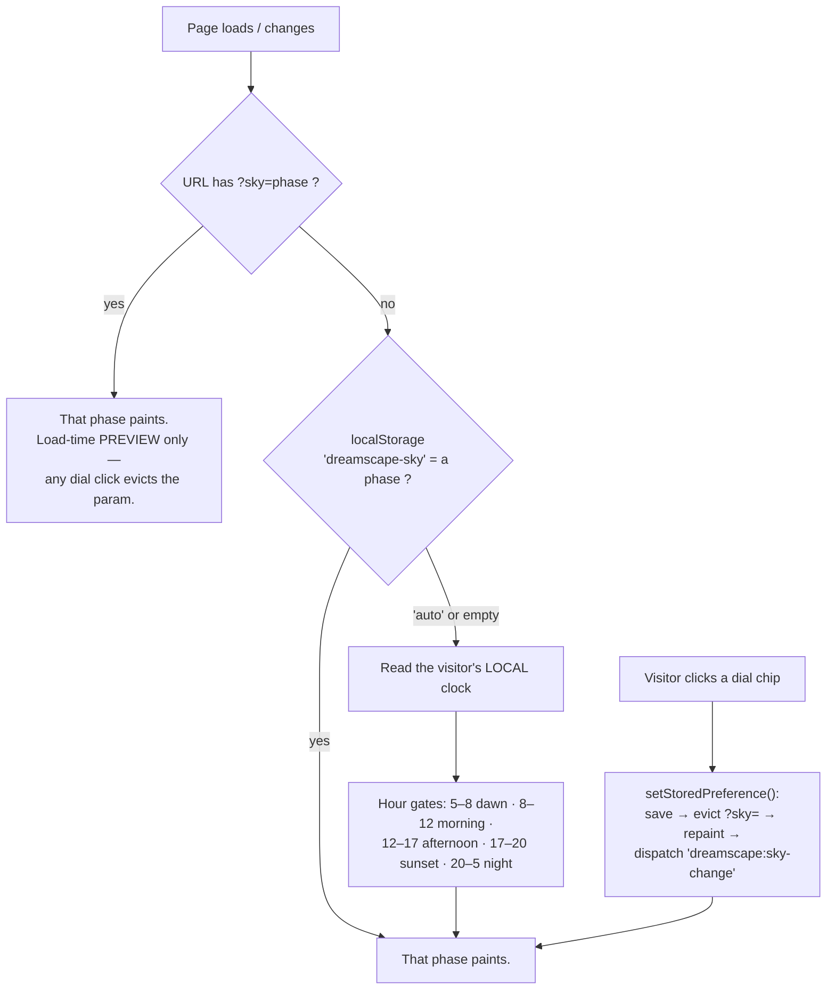

# DREAMSCAPE — Learning Journal

**Owner:** Malek Ben Khlifa · **Path:** `docs/LEARNING.md` · **Start of journal: November 2026**

---

## How to read this file

This is the *technical diary* of DREAMSCAPE — a separate book from the main `README.md`
(which is the project's public journal). Here we record, for every completed stage:

> ① What we built · ② Why we built it · ③ Files changed · ④ Technologies & concepts ·
> ⑤ Key code explanations · ⑥ How the pieces connect · ⑦ Commands used ·
> ⑧ Testing & verification (including *honestly-untested* items) · ⑨ Problems & solutions ·
> ⑩ Lessons learned · ⑪ Glossary (at the bottom, running) · ⑫ Future improvements (at the bottom, running)

**Honesty rules of this journal:**
- Everything here is reconstructed from the *real* Git history and the *real* code — never invented.
- Anything not yet tested is labeled **"manual test pending"** — never silently assumed.
- Chapters are added at the end of every *verified* stage, in chronological order.
- Nothing is ever deleted or rewritten from this file without explaining and getting approval first.

**The Six Project Laws** (police of the whole project — referenced below as Law #N):
1. **Incremental** — one environment at a time (Heart Island first).
2. **Simple milestones** — each stage small, visible, testable.
3. **No heavy libraries until truly needed** — every dependency is approved before install.
4. **Performance tested on mobile, not assumed.**
5. **The owner must understand every change.**
6. **Never delete/overwrite a file silently** — explain, then get approval.

---

## The big picture — how the two worlds talk

DREAMSCAPE is a *hybrid*: an illustrated **DOM world** (HTML + CSS) and, growing into it,
a **3D world** (Three.js inside a React canvas). One single decision-maker — the sky
phase — paints both, which is why they never disagree:



**The phase priority ladder** — who decides *which* phase is active (this exact order
is implemented in `useSkyPhase.js`):



---

# Part 0 — Foundations (the DOM kingdom, before any 3D)

## 0.1 — Project setup & Git/GitHub  *(commit `ce0ec34`, "feat: initial Vite + React scaffold")*

**① What we built.** The project skeleton: a Vite + React (JavaScript — **no TypeScript**)
project named `dreamscape-portfolio`, a Git repository, and a GitHub remote
(`https://github.com/demonmimi/dreamscape-portfolio`, branch `main`).

**② Why.** Vite gives instant dev-server reloads and clean production builds; React lets
us build the interface from re-usable components; Git/GitHub give us history we can
*reconstruct* (this very journal is rebuilt from it) and a public home.

**③ Files changed.** The standard Vite React scaffold (`index.html`, `src/main.jsx`,
`src/App.jsx`, etc.). Later, template cruft was deleted **with approval** (see 0.3):
`src/index.css`, `src/App.css`, the default `*.svg` assets, `src/assets/hero.png`,
`src/icons.svg` — each removal explained first (Law #6).

**④ Technologies & concepts.**
- **Vite** — a build tool: run `npm run dev` for a live-reloading server, `npm run build` to produce an optimized `dist/` folder.
- **React** — a library that renders *components* (JavaScript functions returning markup-like JSX) into the page, and re-renders them when their data changes.
- **Git / GitHub** — local snapshot history (`commit`) pushed to a remote copy (`push`).

**⑤ Key code explanation.** `src/main.jsx` mounts `<App />` into the `#root` div of
`index.html` — the single handshake between HTML and React.

**⑥ How the pieces connect.** Browser → `index.html` → `main.jsx` → `App.jsx` → sections.
**⑦ Commands used.** `npm create vite@latest`, `npm install`, `git init`,
`git remote add origin <url>`, `git add . && git commit -m "…"`, `git push -u origin main`.

**⑧ Testing.** Dev server booted; page rendered. Local commits verified with
`git log --oneline`. **⑨ Problems & solutions.**None recorded — smooth start.

**⑩ Lessons learned.** A clean scaffold committed *before* any custom code means every
later change is diff-able against a known-good baseline.

---

## 0.2 — Design tokens & the Living Sky  *(commit `a944824`, "feat: five-theme Living Sky (crossfade stack, env tokens, override plumbing)")*

**① What we built.** The *color constitution* of DREAMSCAPE:
- `src/styles/tokens.css` — every approved value as a **CSS custom property** ("token"), including the **five approved sky palettes** (dawn / morning / afternoon / sunset / night — exact hour gates 5–8, 8–12, 12–17, 17–20, 20–05) and the **environment tokens** `--env-stars`, `--env-moon`, `--env-sun-glow` (how "present" each celestial witness is per phase), and z-layer tokens `--z-sky -1`, `--z-world 0`, `--z-content 10`, `--z-ui 20`, `--z-overlay 30`.
- `src/styles/base.css` — reset + the **`.sky-stack` crossfade**: all five sky gradients are painted, stacked, permanently; the active phase's layer is simply given `opacity: 1`, so switching skies *crossfades* (CSS `transition`) instead of snapping.
- `src/ui/SkyLayers.jsx` — the component painting the stack.

**② Why.** Colors change together (palette magic), so they must be declared once and
*swapped*, not scattered/hard-coded. The env tokens were designed from day one as
*facts outras media later can obey* — Stage 1 of the 3D kingdom literally consumed them.

**⑤ Key code explanation.** The swap is one attribute check, five rules — nothing is
rebuilt, only revealed:

```css
html[data-sky="night"] .sky--night { opacity: 1; }
/* …and so on for the five phases */
```

**⑥ How the pieces connect.** A later hook makes the `<html>` element carry
`data-sky="night"`, and CSS does the rest — no JavaScript re-painting of colors, ever.

**⑦ Commands.** None new. **⑧ Testing.** Manual phase forcing via `data-sky` while
building; five-phase visual walk. **⑨ Problems & solutions.** A recurring bug taught us
the fix pattern "re-arm events on change" — resolved in the Living Sky v2 rework.
**⑩ Lessons learned.** *Crossfading is cheaper than swapping*: layers that always exist
with controlled opacity beat replacing content — this idea returns as our page-loading
"veil" strategy.

---

## 0.3 — Content system & the homepage  *(commit `4a86322`, "feat: Heart Island home with five-theme atmosphere", plus CTA contrast fix `28a2f94`)*

**① What we built.**
- `src/data/content.js` — the **single source of truth** for portfolio facts (name, tagline, links… with TODOs awaiting Malek's real data).
- `src/sections/Home.jsx` — the Heart Island home: hero copy, flavor line, CTA button inside a **paper letter panel**.
- `src/styles/components.css` — the panel/button design system: the *paper* doctrine (readable content lives on letter-paper panels) and the *glass* doctrine (atmospheric surfaces stay translucent glass).
- `README.md` rewritten as a **first-person journal** (`4c8aba1`).
- The **CTA contrast fix** (`28a2f94`): the invitation was rewritten *on the paper letter* so it stays readable in **all five** sky phases (insufficient contrast over some gradients).

**② Why.** Data separated from presentation means the portfolio can be reworded without
touching design (or vice versa). The contrast fix is Law-of-the-look quality control.

**④ Concepts.** ES module imports as a mini data layer; CSS component classes;
**contrast checking** (text vs background luminance) as a design gate.

**⑦ Commands.** `npm run dev` for visual iteration; `git log` for chapter mapping.

**⑧ Testing.** Visual pass across all five phases (the fix is verified for all five).
**⑩ Lessons learned.** *Accessibility loves mid-tones least*: light text on glass needs a
paper surface behind it — a rule that will follow us into the DOM-over-3D panels.

---

## 0.4 — The Sky-Dial  *(commit `a26c81d`, "fix: dial clicks outvote URL preview — preview tag added, param evicted on choice")*

**① What we built.** The signature UI: a glass chips-palette (`src/ui/SkyDial.jsx`) with
cameo medallions per phase, an **Auto** option, a "preview" tag when `?sky=` is active,
44px-or-larger touch targets, and Escape-to-close. Persistence via
`localStorage["dreamscape-sky"]` with values `auto | dawn | morning | afternoon | sunset | night`.

**② Why.** Visitors get to *own the sky* — and the dial is also our testing device for
every future world feature (every stage is tested through it).

**⑤ Key code explanation — the machinery (in `src/hooks/useSkyPhase.js`):**
- `getStoredPreference()` — reads the saved choice (default `'auto'`).
- `isUrlOverrideActive()` — detects a valid `?sky=` param (load-time *preview*).
- `setStoredPreference(phase)` — saves the choice, **evicts the `?sky=` param** via
  `history.replaceState` (no reload, no history spam — a dial choice *outvotes* the URL forever), repaints `<html data-sky>`, and dispatches `dreamscape:sky-change`.
- `getSkyPhase()` — maps the visitor's **local** hour onto a phase (no timezone code needed — `Date` is already local).
- `useSkyPhase()` — the React hook: lives on the phase, re-checks every 60 s (mid-dream
  visitors get a sky change at the right hour) and repaints *instantly* on the event.

**⑧ Testing.** Manual: every chip across five phases, persistence after reload, URL
preview + eviction. **Honestly-untested:** *click-outside-to-close* (parking lot),
*dial double-gold in Auto mode* (design nuance, deferred).

**⑩ Lessons learned.** *One voice, one ladder*: source-of-truth conflicts vanish when
the order of decision-makers is written down **before** implementing — and events
(`dreamscape:sky-change`) are how siblings talk without knowing each other.

---

# Part 1 — The 3D kingdom begins

## 1.0 — Stage 0: The Canvas Awakens  *(commit `d09741c`, "feat(world): Stage 0 - canvas awakens")*

**① What we built.** The first permanent 3D layer beneath the DOM:
- `src/world/WorldCanvas.jsx` — a transparent `<Canvas>` at `--z-world` (between CSS sky at −1 and content at 10), DPR-clamped `[1, 1.75]`, holding fog + two phase-driven lights. It is loaded **lazily** (`React.lazy` + `<Suspense fallback={null}>` in `App.jsx`).
- `src/world/phaseLighting.js` — the five approved palettes translated into **3D lighting data** (fog hex, ambient/key color+intensity), every value comment-credited to its tokens.css origin.
- A **temporary fog-probe sphere** — fog is only visible ON something, so a labeled probe existed to prove phase fog works. **Retired in Stage 1** with full honors.
- `src/styles/base.css` — the `.world-canvas` layer rule (fixed, full-viewport, `pointer-events: none` — scenery, not interface).
- `src/App.jsx` — mounts `<SkyLayers /> → <Suspense><WorldCanvas /></Suspense> → <SkyDial /> → <main>`.

**② Why.** One stage (the canvas) mounts once and everything later (islands, paths,
furniture) lives inside it. Transparency keeps the CSS sky as the true sky → the
**fallback is by construction**: if WebGL fails, the canvas contributes nothing and the
site stands complete (condition approved before installation).

**③ Files changed.** New: `src/world/WorldCanvas.jsx`, `src/world/phaseLighting.js`.
Edited: `src/App.jsx`, `src/styles/base.css`. Deleted: earlier **Vite template files**
(`index.css`, `App.css`, svgs, `hero.png`, `icons.svg`) — explained and approved first.
No palette/dial/CSS-sky changes.

**④ Technologies & concepts (first contact, one per staircase step).**
- **three** — the WebGL engine (scene, camera, renderer, meshes, lights, fog).
- **@react-three/fiber** (`<Canvas>`) — React bridge: three objects as JSX.
- **@react-three/drei** — the toolbox crate (Stage 1 first opens it: `<Stars>`).
- **Fog** (`<fog attach="fog" args={[color, near, far]} />`) — distant things drown INTO the fog color; the "atmospheric depth" tool.
- **DPR clamp** — device pixels per CSS pixel, capped `[1, 1.75]` so hi-dpi phones don't render 3× cost (Law #4's first line of code).
- **Lazy loading / code-splitting** — heavy modules load only when needed; `React.lazy` + `Suspense` is the React contract for it.

**⑤ Key code explanation.**

```jsx
const WorldCanvas = lazy(() => import('./world/WorldCanvas.jsx'))   // separate chunk
<Suspense fallback={null}><WorldCanvas /></Suspense>                // null: CSS sky covers the wait
```

```jsx
<fog attach="fog" args={[L.fog, 12, 30]} />
```
"Attach fog to THIS canvas's scene; near = 12 units, far = 30; tint = the phase's fog hex."
Also note `getPhaseLighting(phase)` always returns full data, falling back to **afternoon** — the same default `:root` tokens.css uses.

**⑥ How the pieces connect.** `useSkyPhase()` → `phaseLighting.js` → fog + lights.
The DOM asks `useSkyPhase` too (via `data-sky`); two media, one decision-maker.

**⑦ Commands used.**
```
npm install three @react-three/fiber @react-three/drei   # installed with explicit approval (Law #3)
npm run build                                            # verify + read the bundle report
git log --oneline --decorate -12                         # the journal's fact-check key
```

**⑧ Testing & verification (user-verified ✅).** Five-phase fog/gradient response
(night = moonlit violet & dim, afternoon = brightest warm, sunset = magenta), layering
(content readable, CTA clicks pass through canvas), fresh `npm run dev` boot, console
clean, homepage always functional. **Honestly-untested / logged:** no-WebGL failure
simulation (Phase 9 checklist), fallback under deep-legacy browsers.

**⑨ Problems & solutions.**
1. **The bundle jump:** three.js pushed the main bundle to **1,144 kB**. Fix within the same stage: `React.lazy` split → **main 226 kB**, three.js chunk **919 kB** loaded *after* first paint (CSS sky covers the gap). Remaining >=500 kB chunk warning: *known and accepted* for now (further split logged in Future Improvements).
2. **The false error:** `npm run build` exits **code 1 even on success** — PowerShell flags Vite's stderr output (e.g. that warning) as NativeCommandError. The verdict = the green **`✓ built in …`** line, not the exit code. *(Still true in Stage 1.)*
3. **A lying comment caught in self-review:** the fallback comment said "PHASES[0]" while the code used afternoon. Fixed immediately — *comments must tell the truth*.
4. **Vulnerability count** ("6 moderate"): identical to pre-3D levels (dev-toolchain advisories), logged for Phase 10; **not** caused by the three libraries.

**⑩ Lessons learned.** Load big worlds on the *back roads*, not the front door (lazy chunks);
art direction and performance are the same discipline (one fog == one palette line);
and commit messages are future-Malek's archaeology tool — this stage's chapter is built
*from* the commit `d09741c`.

---

## 1.1 — Stage 1: The Living Sky — **IN PROGRESS, not yet verified**

| Approved doors | State |
|---|---|
| Initial scope (drei `<Stars>`, true-outline crescent, feathered glow, phaseLighting columns) | ✅ implemented, first build green |
| **Scope expansion (approved mid-stage): realism of Sun & Moon** | ✅ implemented in the same delivery |
| Dependency `astronomy-engine@2.1.19` | ✅ installed **with explicit approval** — 1 package, zero sub-deps, ~54 kB added to the async world chunk (923 → 977 kB) |

### 1.1.a — Concepts taught during implementation (draft; final verified versions ship with the chapter)

**Sky phases vs astronomical time.** A *phase* is an artistic 3–5-hour color
brand chosen by the dial's ladder; *astronomical time* is the continuous real
clock (hour:minute:second) whose sky crawls ~15°/hour. They were entangled in
early Stage 1 (the moon "reigned" because Night reigned). The approved two-axis
model decouples them: **the dial paints; astronomy positions.** Consequence:
choosing `?sky=morning` in the real afternoon *changes colors only* — the sun
stays where it truly is, possibly off-frame high, possibly hidden.

**Azimuth and altitude.** Think of standing outside pointing:
- **Azimuth** = the compass bearing of a direction: 0° = North, 90° = East,
  180° = South, 270° = West. The sun's azimuth sweeps ~180° across the day
  (in Tunis's November: ~112° at sunrise → ~180° at noon → ~247° at sunset —
  reading "southeastern morning, southern noon, southwestern evening").
- **Altitude** = vertical angle: 0° exactly on the horizon, 90° overhead
  (zenith), negative = below the horizon. Tunis is too far north for the sun
  to ever reach 90°; in November noon peaks near 36° — a *seasonal* number
  that recomputes itself every day.
- Worked conversion (the one implemented, `celestial.js`):
  `x = −R·cos(altTilt)·sin(az)`, `y = R·sin(altTilt)`, `z = R·cos(altTilt)·cos(az)`
  — with the world's compass chosen for the stage: **south = −Z (ahead of
  camera), north = +Z (behind), east = −X (left), west = +X**, physically
  correct for a northern mid-latitude viewer facing south.

**Sunrise / sunset / moonrise / moonset.** Definitions: body's altitude
crosses 0° (technically a breath below — air refraction bends light ~0.8°,
handled by the engine's `Refraction.Normal`; the Moon additionally has a
~1° parallax lift, also handled). "Phase says night but moon has set
down there" is exactly what the horizon law forbids drawing.

**Celestial → Three.js coordinates.** The chain implemented:
1. `astronomy-engine` (observer = Tunis, date = visitor's real clock)
   → azimuth + altitude, topocentric + refracted.
2. Compass mapping (south-forward) — *why:* the canvas camera faces −Z;
   a mid-latitude sun spends its day southward, so south must be ahead.
3. Two honest artistic knobs in `observer.js`: `CELESTIAL_RADIUS = 55`
   (the storybook sky-dome distance) and `SKY_TILT = 0.58` (elevation
   compression — measured problem: noon sun at ~36° exceeded the camera's
   ±22.5° view; drawing altitude × 0.58 keeps noon's sun ON the stage.
   The horizon law uses the REAL altitude — compression never cheats
   what's below the horizon).
4. One clock, read per minute (`useCelestialSky`), smoothed by
   **frame-rate-independent damping** (`lerp(target, 1 − e^(−Δt·2.5))`)
   — minute-sized nudges melt into drift.

**Sun disc treatment.** New `Sun.jsx`: warm self-lit disc + halo, same
damping; **below horizon = invisible** (the hard truth); **its tint** comes
from the new `sunColor` dial column (dawn ember-gold → afternoon bright
gold). The HorizonGlow now *leans* (≤16 world units) toward the sun's
azimuth — dawn pools from the east/left, dusk from the west/right.

**Files of this stage (declared before creation, all from git diff to come):**
new `src/world/{observer.js, celestial.js, useCelestialSky.js, Sun.jsx,
StarField.jsx, Moon.jsx, HorizonGlow.jsx}` · edited `phaseLighting.js`
(+4 columns then +`sunColor`), `WorldCanvas.jsx` (probe retired).

### 1.1.b — Debugging log (the first test failure, and what it taught)

**Symptom (user report):** stars visible, but Sun and Moon invisible in
Auto AND in every manual theme; no perceivable star movement.

**Investigation — reproduce first, argue later.** Two diagnostic runs of the
*actual* module (not a re-implementation) via Node:
`import('./src/world/celestial.js')` → `getSunSky() / getMoonSky() /
skyToWorld() / horizonFade()`, plus a standalone script asking
astronomy-engine directly for Tunis, several hours:

```text
SUN  07:00 az=110.8° alt=+1.8°   12:00 az=179.1° alt=+37.7°  17:00 az=248.2° alt=+2.8°
MOON 12:00 az=250.0° alt=+30.7°  (up, west-southwest, ~half-phase)
-now- SUN alt −61° · MOON alt −44°  → both below horizon at test time
```

**Root cause #1 — no bug in positions, a missing instrument.** The whole
test happened during real Tunisian night: sun −61°, moon −44° — both
honestly below the horizon, and manual `?sky=` themes must not move them
(the two-axis contract). So "invisible" was astronomically correct — but
*untestable*. Fix: `?t=HH:MM` (or `?t=HH`) — a time-travel lever in
`celestial.js` (`currentInstant()`), completely separate from `?sky=`:
it fakes today's Tunisian wall-clock (fixed UTC+1 offset math, invalid
values fall back to real time). The dial still owns paint only.

**Root cause #2 — NaN from a renamed field (real bug).** astronomy-engine
2.1.19 calls the illuminated fraction `phase_fraction`; we originally read
the nonexistent `mag_ratio`, so `sky.illuminated = undefined` and the
halo opacity formula `0.08 + 0.08·undefined → NaN` was written INTO a
material. NaN opacity renders nothing specific — a glow that simply
isn't trustworthy. Fix: read `phase_fraction` + a `Number.isFinite`
guard so a future field rename can never again poison a material.
*Lesson: verify a library's return SHAPE, not its folklore; a NaN path
dies silently, so guard every value that flows into a uniform.*

**Root cause #3 — drei `<Stars>` ignores material.opacity (real bug).**
Its fragment shader simply never multiplies by opacity, so the approved
star fade (dawn 0.25, day 0) silently never applied. Replaced with our
own ~35-line round-soft-point shader that obeys opacity by construction
(same trick as HorizonGlow's feather — no texture, no new dependency,
drei stays for future stages). Motion explained honestly: individual
stars do not wander; the sheet rotates around the **celestial pole**
(axis tilted by the observer's latitude over due north = our +Z) at the
Earth's true rate 15°/h (0.25°/min) — subtle by nature — plus a slow
±15% twinkle.

**Debug aid (temporary, by design):** `DEBUG_CELESTIAL = true` in
`observer.js` — Sun/Moon render at full strength with a thin magenta
locator ring so positions are unmistakable; **flip to `false` after
verification** to restore the dreamy look. It ignores washes but never
the horizon law — below the horizon stays hidden, because the `?t=`
lever brings bodies up honestly.

**Verified by tooling (not just theory):** build green (main still
226 kB; world chunk 977.5 kB); module probe shows `illum=0.192` (real
waning crescent) and a finite halo opacity. Visual five-phase pass —
**pending user verification**.

### 1.1.c — The course correction: from ephemeris to choreography

**What happened.** After the astronomy stage, real testing disappointed:
the stars vanished (a genuine rendering bug in the new points shader was
*not* the whole story — the *concept* failed too), and the Sun/Moon never
presented the storybook moments the Founder wanted. Lesson: the previous
§1.1.b fixes answered the bugs, but the original §1.1 requirement itself
over-reached for a portfolio.

**The decision (approved by the Founder, recorded on request).** The
portfolio needs *believable and beautiful*, not *astronomically exact*:

| Astronomical approach | Art-directed choreography (shipped) |
|---|---|
| Real Sun/Moon positions needed precise observer data, ran `astronomy-engine` (~53 kB) | Five hand-placed keyframes over 24 h — zero libraries |
| Invisible much of the day when looked at "wrong" hours; hard to art-direct | Each phase has a *guaranteed* composition (the Founder's list, verbatim) |
| `?t=` had to fake tunisian day math | `?t=HH:MM` trivially maps to a decimal hour |

**The removed astronomy pieces (with records, Law #6):**
- `astronomy-engine` — `npm uninstall` (bundle back from 977 → 926 kB)
- `src/world/observer.js` — deleted (held the Tunis observer + SKY_TILT
  storybook projection; the projection is replaced by honest on-screen
  keyframe coordinates)
- `src/world/useCelestialSky.js` — deleted (engine-calling hook)
- `celestial.js` — fully rewritten as the choreography (see below)
- `phaseLighting.js` — the dial's own `starsAlpha`/`moonAlpha` columns
  retired: the clock choreography now drives those opacities, and keeping
  them would have created a second, lying source of truth.

**The new system, in beginner terms:**
1. **Keyframes** (`CHOREO` in `celestial.js`) — six records: an hour of
   day + where the Sun is (x, y, strength), where the Moon is + strength,
   and star strength. They are *art data*, chosen to satisfy the Founder's
   five-phase list and verified inside the camera's frame (edge of view at
   the sky's depth ≈ ±33° horizontal, +23° up).
2. **Interpolation** — at any real moment, the sky state is a
   `smoothstep` blend of the two keyframes bracketing the hour. The
   smoothstep (a slow-quick-slow curve) makes glides feel *held* at
   each phase's look and *flowing* between phases — that's how we get
   "sun rising between dawn and morning" with only six keyframes and
   no animation code: position targets are damped per frame in
   Sun/Moon (`lerp by 1 − e^(−Δt·k)`), and the same trick smooths
   their opacities. Opacity is a *number the shader obeys*
   (`uniform uOpacity` — the earlier drei finding, §1.1.b, stays true:
   a shader must read it or it silently ignores it).
3. **The night plateau** — two identical NIGHT keyframes (20:12 and
   04:00) sandwich midnight with no movement in between: night breathes,
   it doesn't tick. Between 20:12→04:00 the blend of two *equal* states
   is a constant.
4. **Ownership** — clock owns WHERE + HOW STRONG (positions, alphas,
   star strength); dial owns the MOOD (fog, lights, glow, sun tint).
   `?sky=` and `?t=` are separate URL levers, testable in any
   combination (`?sky=sunset&t=7` = sunset colors, dawn choreography).

**Debug aid relocated:** `DEBUG_CELESTIAL` moved into `celestial.js`,
default `false` — dreamy look is the shipped look.

### 1.1.d — Final polish round: three deeper lessons (verified visually + pixel-by-pixel)

After §1.1.c, headless screenshot review found more wrongnesses. Each fix
taught a lesson bigger than itself:

**Lesson 1 — "the grey egg" = a feather across only 10% of the disc.**
The sun's wide halo rendered as a visible pale circle. Cause: my GlowDisc
factor `feather = 1 − smoothstep(uSoftness, 0.5, d)` — with uSoftness
0.45 the fade occupied only the *outer 10%* of a radius-[0..50%] unit,
so 90% of the disc was flat. Fix: `(1 − softness)` is now the **fraction
of the radius where the fade begins** — `edge = (1 − softness) × 0.5` —
softness 0.08 (sun core) fades in the last 8%, 0.45–0.5 (halos) fade
across half the disc. Rule: **a feather must span most of the surface;
a smoothstep placed near the rim is a plate with a soft edge.**

**Lesson 2 — one arc flag broke the whole crescent shape.**
With `aClockwise=true`, three.js' `absarc` sweeps the LONG way around the
bite circle (240° through its far side), giving a proper C; flipping it
to `false` enclosed the whole moon (a gibbous disc — visible instantly in
a screenshot). Also explored: the mysterious "dark disc" behind the
crescent turned out NOT to be geometry at all — see Lesson 3 — and the
original flag was correct all along. Rule: **an absarc's `clockwise`
flag is about sweep *direction*, not which side is open; CDP-pixel
recoloring (magenta bisection) proved the fill, screenshots proved the
flag's effect.**

**Lesson 3 — screenshots lied: the premultiplied-alpha lesson.**
NIGHT looked like a huge dark disc sat behind the crescent, and the
afternoon sun wore a grey "egg." A framebuffer probe (`gl.readPixels`
through the live WebGL context, captured in the temporary
`pixelprobe.cjs`) showed the canvas held **no dark pixels whatsoever**:
the crescent's hole was `rgba(0,0,0,0)`-ish and the glow pixels held
exactly `color × alpha` (premultiplied gold, α ≈ 0.12). The canvas was
CLEAN; the darkness appeared only when the headless capture pipeline
*re-multiplied rgb by alpha* during compositing — an artifact of the
probe, not of the scene. A real browser (canvas context is
`premultipliedAlpha: true`) composites those same pixels as **sky
lightened by a warm 12% veil** — the intended glow. Consequences:
- Glow layers now use **normal (alpha) blending** — deterministic in
  every environment; additive was chasing the phantom.
- **Screenshots are trustworthy for opaque content** (crescent body, sun
  core, stars, DOM, positions) and systematically WRONG for
  translucent-on-transparent glow; glow correctness is verified by
  framebuffer readback + compositing math instead.

**The verified final state (every claim checked in a screenshot or by
framebuffer probe):**

| Phase | Sun | Moon | Stars | Extra |
|---|---|---|---|---|
| dawn | left/east, soft ember α 0.6 | upper-right, α 0.14 | 0.25 | glow leans east |
| morning | left/east, brighter, higher α 1 | α 0.05 (gone) | 0 | fresh light |
| afternoon | centered high α 1 | — | 0 | brightest phase |
| sunset | right/west ember α 0.85 | left/east α 0.5 | 0.2 | glow leans west |
| night | hidden | centered-high α 1 | 1 | moon plateau kfs at 20.2 & 4.0 |

Keyframes (world units, sky plane z=−46): dawn sun (−27, y 4.8), morning
(−16.5, 10.8), afternoon (0, 12), sunset (27, 4.6); moon dawn 24/10.6,
sunset −24/11, night 3/9.5. All cap within the camera's view cone
(±33° horizontal, +14.7° up at that depth — the earlier −7.8° downward
camera tilt is baked into these numbers).

**Stage-1 file map after the polish:**
- `celestial.js` — CHOREO (6 keyframes), `celestialStateAt` (smoothstep
  blend), `currentSkyHour` (`?t=`), `useSkyClock`, `DEBUG_CELESTIAL=false`
- `GlowDisc.jsx` — the feathered soft-light primitive (internal damping;
  uniforms written through the live material ref)
- `Sun.jsx` — 3 GlowDisc layers (core/disc/halo); `Moon.jsx` — computed
  crescent + GlowDisc halo; `StarField.jsx` — custom points shader (the
  drei-stars opacity lesson stands), slow drift, gently twinkle
- `HorizonGlow.jsx` — feathered band, `leanX` follows the choreography
- `WorldCanvas.jsx` — mounts all; debug hook REMOVED after verification

**Cleanup honor roll (Law #6):** temporary probes `shot.cjs`,
`inspect.cjs`, `magenta.cjs`, `bisect.cjs`, `arbitrate.cjs`,
`pixelprobe.cjs` and all probe screenshots deleted after use; the
`window.__dreamStage` debug hook removed from WorldCanvas.

**Build:** ✓ main 226.03 kB, WorldCanvas chunk 926.92 kB (Stage-1 owned
code ≈ a few kB; the chunk is three.js itself; splitting parked Phase 9).

*Stage 1 remains **not yet complete**: verification now belongs to the
Founder (five `?t=`/`?sky=` combos)*.

### 1.1.e — The object-centric choreography (Founder's independent-bodies refinement)

After visual testing, the Founder refined the design: the Sun and Moon
should not share one timetable — each body needs **its own keyframes,
its own timeline**, with stars fully independent too. The v2 shared
table (`CHOREO` with one `hour` bundling sun+moon+stars) made the Moon's
transitions a hostage of the Sun's beats, embedded no scale or glow
choreography, and hid glow numbers inside components.

**The v3 structure — three independent lists in `celestial.js`:**
- `SUN_KEYFRAMES` — six flat rows: `hour, x, y, z, opacity, scale, glow`
- `MOON_KEYFRAMES` — six rows, same shape, **its own hours** (the moon
  lingers ~30 min longer into morning: its morning row sits at 10.5
  where the sun's is at 10.0 — independence you can SEE)
- `STARS_KEYFRAMES` — six rows: `hour, alpha` alone

The property dictionary is written in the file header so a keyframe row
reads like a stage direction: `x/y/z = where, opacity = how present,
scale = how big, glow = how strong the halo melt (1 = usual)`.

**One generic interpolator, three independent timelines.** A single
`sampleKeyframes(frames, hour)` (the already-verified smoothstep +
midnight wrap, now generic over a row's numeric fields) is executed once
per list. `celestialStateAt(hour)` returns `{ sun, moon, stars }` — each
consumer takes only its own branch; nothing shares a field.

**Component wiring (minimal, per Law: don't rewrite what works):**
- `Sun.jsx` — reads `state.opacity / scale / glow`; scale damps in
  `useFrame` exactly like position; layer strengths became named
  constants (`DISC_STRENGTH 0.8`, `HALO_STRENGTH 0.22`) so no magic
  numbers remain; the per-phase strength comes from the keyframe.
- `Moon.jsx` — same pattern (`MOON_HALO_STRENGTH 0.12`); the hard
  `MOON_SCALE = 4.2` constant retired — scale is choreographed now
  (the moon rides smaller when faded: 3.2–3.6, full 4.2 at night).
- `WorldCanvas.jsx` — renamed fields only (`sky.stars.alpha`).
- `StarField.jsx` — untouched (already independent, opacity-obeying,
  slow drift, gentle twinkle).
- **Zero changes**: CSS, palettes, tokens, dial, homepage, GlowDisc.

**No-overlap safety rule (kept from v2):** a body is parked **below the
horizon** (`y: −5/--/−8` beyond frame) whenever its opacity reaches 0,
so an invisible object can never leak, streak, or cross the visible one.

**Verified in the browser (headless probe, all console-clean):** dawn
✓ faded moon upper-right + ember sun east + faint stars; morning ✓ east
sun, moon nearly gone; afternoon ✓ centered high sun only; sunset ✓
ember sun west + subtle crescent east + returning stars; night ✓
centered glowing crescent + full sheet; **cross-axis check**
(`?sky=afternoon&t=22`) ✓ afternoon *colors* with night *choreography*
— dial and clock proven independent. (Translucent glow elements are
verified by framebuffer readback + compositing math — the headless
capture pipeline mangles translucent-on-transparent pixels, §1.1.d.)

**Build:** ✓ main 226.03 kB · WorldCanvas chunk 927.53 kB.
*Stage 1 still awaits the Founder's personal verification before any
commit.*

### 1.2 — v4: the continuous 24-hour world and the ONE clock

The Founder's refined spec: exact five-phase gates, **independent dense
24 h timelines** for Sun/Moon/stars (no jumping at phase boundaries, no
frozen plateaus, invisible bodies keep traveling), one clock that drives
**EVERYTHING** (colors + choreography + fog/lights together), a playable
time control, and a clearly separated artistic-mood override.

**What blocked the continuous cycle before (inspection findings):**
1. ~6 sparse rows/object → identical plateaus froze the sky ~7.8 h
   (20:12→04:00 was *the same numbers*, so nothing moved at night).
2. Invisible objects *parked* instead of traveling — reappearing meant
   reappearing in place, never continuing a journey.
3. Stars froze whenever alpha ≤ 0.02 (`root.visible=false` + early
   return stopped both draw AND drift) — dusk resumed from a stale spot.
4. **Split-brain clocks**: `celestial.js` read `?t=` for positions while
   `useSkyPhase.js` read the real `Date` for colors → `?t=9` could show a
   morning sun under a night sky. (Exactly the contradiction that is now
   forbidden.)

**The four moves that fixed it:**

1. **Dense full-cycle timelines** (`src/world/celestial.js`) — per-object
   rows now cover all 24 h, *including the invisible hours*: a row with
   `opacity: 0` is a real stage direction, the body glides on ("backstage"
   rows sit below the horizon, y ≤ −2, outside the frame's view cone).
   Row counts: SUN 13 · MOON 15 · STARS 14. The Sun slides west→east
   **below the world** between 23:48 and 02:30 so dawn re-entrance from
   the east is continuous; the Moon slips below the western edge ~10:00,
   crosses under the world ~13:00–15:00, and rises a sliver by 16:30.
2. **Interpolation choice (documented decision)**: per-segment
   **smoothstep**, deliberately, and **Catmull-Rom rejected** — a
   Catmull-Rom spline can *overshoot* its samples (the curve bends
   sideways between points), which would make a celestial body drift
   *backward*. Smoothstep only ever blends its two neighboring rows, so
   no value can pass a neighbor. With dense rows the "hold-and-flow"
   reads as dreamy gliding, C0-continuous across every boundary and
   midnight (wrap bracket = last row → first row + 24 h).
3. **The ONE clock** (`src/hooks/dreamClock.js`) — a tiny module store
   (state above React because three+ components read the same hour):
   `mode auto|manual · hour · playing · speed`, a 250 ms ticker (Auto
   announces only when the minute actually turns; Manual+playing advances
   `250 ms × speed / 3.6 M` hours per tick, wraps `% 24`), announcements
   via `dreamscape:time-change`. `?t=HH:MM` seeds Manual, frozen (the
   test lever), called once from `App.jsx`. Speeds: ×1 real-time,
   ×60 = a day in 24 min, ×300 = a day in ~4.8 min.
4. **The phase follows the clock** (`useSkyPhase.js`) — new exact gates
   in `getSkyPhaseAt(hour)`: dawn 05–06 · morning 06–12 · afternoon
   12–17 · sunset 17–21 · night 21–05 (wraps midnight). The hook
   subscribes to the clock, so a slider drag repaints `data-sky` and the
   whole world in one beat. `?sky=` / localStorage remain an *optional
   artistic override* (colors only; positions stay clock-owned).

**The unassigned hour — 04:00–05:00 (documented decision):** no sixth
phase exists. The state machine keeps five labels; Night runs 21:00→05:00
and the last hour is the **twilight bridge** *inside Night's label*: no
repaint, no sixth look. Its smooth Night→Dawn feeling is delivered by the
choreography (stars 0.85→0.5, moon ghosting to the upper-right at α 0.35,
the sun already sliding toward the eastern horizon to kiss it at 05:00)
plus the ~2 s palette crossfade at the 05:00 boundary. At 04:30 the pill
honestly reads **Night**.

**Sky-Dial two sections (`SkyDial.jsx` + `components.css`):**

| Section | Controls | Owns |
|---|---|---|
| ⏱ **Time of day** | "Follow real time" (Auto), 24 h readout, ▶/⏸ play, ×1 ×60 ×300, slider 0–23:55 step 5 min | THE clock — colors + choreography + fog/lights follow it |
| 🎨 **Artistic mood** *(optional — colors only, time stays yours)* | "Follow clock" (= stored `auto`) + the five phases | color mood only; **never moves the Sun/Moon/stars** |

Slider snapping: `SLIDER_STEP = 1/12` (48 steps/day); speed chips set
`setSpeed` + enter playing manual mode; simulation controls disable (and
visually rest) while Auto owns the clock.

**Coder continuity note (StarField):** the group is now ALWAYS visible
and ALWAYS drifting; `uOpacity` does the hiding (the custom shader
discards sub-0.004 pixels); alpha eases through `alphaRef` damping so
linked `alpha` values glide, never snap. Lesson generalized: *hide with
opacity, freeze nothing — a frozen hidden thing wake-stutters.*

**Verification (headless Edge probe, `shot.cjs`/`numeric.cjs`, both
deleted after use):**
- Build ✓ (`✓ built in 378ms`; main 229.05 kB, WorldCanvas chunk 928.25 kB).
- 12 required times screenshotted ✓ — 04:30, 05:30, 06:00, 09:00,
  12:00, 14:00, 17:00, 18:30, 21:00, 23:00, 00:30, 03:30. All pill
  labels honest (04:30 = Night, twilight bridge); moon visibly glides
  21:00→23:00→00:30→03:30; sun off-stage during night.
- 5 boundary pairs ✓ — 05:58/06:02, 11:58/12:02, 16:58/17:02,
  20:59/21:01, 23:55/00:05: positions essentially unchanged across each
  gate while colors crossfade softly. Zero position jumps.
- Numeric sweep (0.02 h resolution over 24 h + wrap): max per-sample
  deltas = sun.x 0.60 @01:10, moon.x 0.83 @14:02 (the hidden crossing),
  opacity ≤ 0.02/sample — **no boundary spike anywhere**. Gate labels
  exact at every edge minute (23:99 night, 00:00 night, 21:00 night…).
- Dial open panel screenshotted ✓ — both sections render, `?t=` Manual
  mode shows the readout + resting ▶ + slider, "Follow real time"
  correctly NOT active, mood correctly "Follow clock".

**Numbers in the timeline worth remembering:** camera framing caps x ≤
±28 at the sky plane z=−46; noon sun y = 12.2; night moon y 9.5–10.6;
below-horizon rows y ≤ −2 (usually −5/−6).

### 1.3 — v4.1: one synchronized world (the atmosphere follows the hour)

The Founder's v4 verdict: the celestial glide was right, but the *colors*
still stepped. Root cause found by inspection — **two different input
kinds**: the choreography samples the numeric hour (`environmentAt`
continuity), while the color chain (`tokens.css` swaps → `SkyLayers`
crossfade stacks → `phaseLighting.js` static tables) only ever repainted
at the five *labels* — stair-steps at 05/06/12/17/21, plus instant fog /
light prop swaps inside the canvas getPhaseLighting.

**The fix — ONE shared time-derived state, zero new clocks, zero
duplicated palettes:**

1. **`src/world/skyEnvironment.js`** — the single source of the whole
   atmosphere:
   - reads the five palettes **directly from tokens.css** at startup
     (`getComputedStyle`) — the Constitution stays the only palette
     truth; no hex is copied into JS. All values leaving the module are
     finite/guarded (the §1.1.b NaN lesson).
   - the 3D lighting table moved here from phaseLighting.js (identical
     values; `phaseLighting.js` is now a wrapper re-export, keeping the
     old import path alive with no second truth).
   - **`environmentAt(hour, overridePhase)`** — an override returns that
     phase's *pure static* environment (the dial-axis stays crisp and
     clearly separate); otherwise it blends the two bracketing phase
     palettes + lighting entries across the **ramp windows**:
     night→dawn **04:00–05:00** (the twilight bridge, arriving at pure
     Dawn exactly at 05:00); every other gate ±20 min (05:40–06:20,
     11:40–12:20, 16:40–17:20, 20:40–21:20); night plateau 21:20–04:00.
     The ramps *straddle* each gate, so colors cross it continuously —
     the palettes stay recognizable (e.g. pure Dawn 05:00–05:40).
   - also owns `getSkyPhaseAt` now (one gate-truth list next to the
     ramps; `useSkyPhase` re-exports it so import paths endure).
2. **`applySkyPhase()` became the live stamper** — it already ran on
   every clock announcement (Auto minute-ticks, slider drags, playback),
   so it needed no new wiring: while following the clock it writes the
   blended palette as INLINE `--sky-top/mid/low` (inline style beats the
   tokens' attribute rules by CSS priority — no `!important`) plus
   `<html data-sky-live="on">`; with an override it removes the inline
   tokens and stamps `data-sky-live="off"` (classic stack takes over).
3. **`.sky--live`** (sixth layer in `SkyLayers`, styled in `base.css`)
   paints the active slots in the *exact same gradient geometry* as the
   five palettes (0%/55%/100%) — colors glide, no crossfade needed. The
   classic five-layer stack remains for overrides, `?sky=`, and no-JS.
   The base layer is deliberately first in the stack and the live rules
   deliberately last in base.css (equal specificity → cascade order
   decides; nothing resorts to `!important`).
4. **WorldCanvas** — `getPhaseLighting(phase)` →
   `environmentAt(hour, getActiveOverride())`: fog color, ambient/key
   light color+intensity, glow, sun tint all glide per tick. The fog is
   created once and re-colored imperatively (`SkyFog` + `THREE.Fog`) so
   announcements never remount it (the prop-args remount staircase,
   retired).

**Two bugs caught by the numeric sweep before shipping** (worth
remembering): the parsed palette table initially leaked `[r,g,b]`
arrays from the *pure plateau* path → `"187,139,201"` as an inline
color value = invalid CSS gradient; fixed with `hexifyPalette()` guard
(all module exits now guarantee hex strings). And a duplicated export
caught by the build first (leftover gate function in `useSkyPhase`).

**Verification (headless Edge probes, all deleted after use):**
- Build ✓ (`✓ built in 376ms`).
- Numeric: at 0.02 h sampling, max per-sample jump ANYWHERE (incl. the
  four ramps + midnight) = **6–7/255 per color channel** in the gradient
  and ≤ 0.034/unit for light intensities — the ramp crossing of every
  gate is smooth; 23:59→00:00 identical colors. The twilight bridge
  stands Night's palette at 04:00, Dawn's at 05:00, smoothstep between.
- Screen set ✓ (10 required times + 5 boundary pairs): 04:30 genuinely
  ambiguous mauve (neither night indigo nor dawn pink); 05:30 pure
  Dawn; 06:00 mid-ramp lavender→blue; 14:00 pure brightest afternoon;
  17:00 visibly mid-ramp; **18:30 exactly the Founder's vision** (sunset
  sky, ember sun west, crescent east, stars trickling back); 23:00 deep
  indigo plateau; boundary pairs pixel-close across each gate.
- DOM stamp check ✓ — `data-sky-live="on"`, inline `--sky-top` correct,
  `.sky-live` opacity 1 while stack layers rest at 0, body gradient
  riding the inline tokens.
- Override discipline ✓ — `?sky=sunset&t=9`: sunset *colors*, morning
  *sun position* (the two-axis contract), "preview" badge on the pill;
  `environmentAt(9,'sunset')` ≡ `environmentAt(18.5,'sunset')` (static).
- Dial unchanged ✓.

*Stage 1 remains uncommitted — awaiting the Founder's synchronized-day
verification (playback across boundaries is the last personal test).*

### 1.4 — v4.2: the Artistic Mood buttons become complete-look previews

The Founder's focused correction: a mood pick must preview the WHOLE
atmosphere — the mood's Sun/Moon/stars too, not just colors — while
leaving the clock (auto/manual/playing), the slider and playback
completely alone.

**The smallest change that does it (no second clock, no duplication):**
both consumers already sample by *some decimal hour*, so the preview is
an **hour redirect, never a clock write**:
- `celestial.js` gains `MOOD_PREVIEW_HOURS = { dawn 5.3, morning 7.0,
  afternoon 13.0, sunset 18.5, night 22.0 }` — one hour inside each
  phase's PURE palette plateau whose keyframe choreography already IS
  the canonical composition (dawn sun kissing the east horizon +
  ghosted moon + faint stars; afternoon sun near center alone; sunset
  ember + crescent east + returning stars; night crescent center-high
  + full sheet). Listed verbatim with the Founder's configurations.
- `WorldCanvas` computes `lookHour = override ? MOOD_PREVIEW_HOURS[override]
  : clock.hour` and samples BOTH the colors (`environmentAt(lookHour,
  override)` — already static under an override) and the celestial
  state (`celestialStateAt(lookHour)`) from it. Release ("Follow clock")
  just re-points the sampler at the real hour; the damped components
  glide the world back — no snaps, nothing cleared.
- Wording honesty: the dial's mood-section label and doc comments now
  say the pick is a *full look preview; time keeps its course* (the old
  "colors only" text would have lied).
- The "preview" badge stays; `?sky=` inherits the same complete-look
  preview behavior automatically (same override channel).

**Rule worth keeping:** moving a *renderer's sample point* is not the
same as moving the *source of truth* — the mood reads the world's data
at a chosen hour while the clock's hour (and playback progress)
continues untouched underneath.

**Verification (headless probe, through the REAL dial buttons, all
probe artifacts deleted after):** build ✓ (379 ms). The five moods ✓ —
each shows its full composition + pure palette with the pill badge.
Founder's four cases ✓:
1. Manual 23:00 → Morning mood: readout stayed **23:00**, dial shows
   Morning gold, sky renders the Morning look over frozen time;
2. "Follow clock" → the full 23:00 Night environment restored
   (data-sky night, live on);
3. Auto (real 02:05 night) → Sunset mood → released: stored pref back
   to `auto`, real-time night restored with the clock untouched;
4. Playback ×300 from 20:00: under the Night mood the readout kept
   advancing 20:12→20:22→20:31, and after release the world matched the
   *advanced* hour (numeric proof: the real-hour moon sample −8.2 →
   −8.0 across the release), i.e. the preview ran as a frozen look over
   a live clock, then handed back cleanly.

*Stage 1 still uncommitted — the five-button pass belongs to the
Founder.*

---

# Glossary (running)

| Term | Plain meaning |
|---|---|
| **CSS custom property (token)** | A CSS variable (`--name: value`) — one declaration, referenced everywhere; palette magic's backbone |
| **CSS attribute selector** | `html[data-sky="night"] …` — CSS that activates when an HTML attribute holds a value |
| **crossfade stack** | Layers that all exist; the active one gets `opacity: 1` (with transition) — no swapping, just revealing |
| **event dispatch / listener** | `window.dispatchEvent(...)` + `addEventListener`: how unrelated components announce & react, without knowing each other |
| **localStorage** | A tiny browser key-value store that survives reloads; ours: `dreamscape-sky` |
| **URL search param** | The `?sky=sunset` after a URL — a load-time test lever |
| **history.replaceState** | Change the URL *without* reloading or creating a history entry |
| **priority ladder** | The written order of decision-makers: URL preview → stored choice → clock |
| **hook (`useSkyPhase`)** | A function giving React components live data; re-checks every 60 s + on events |
| **WebGL** | The browser's 3D drawing capability — the engine under three.js |
| **`<Canvas>` (fiber)** | The stage: a React-wrapped WebGL surface holding a three.js scene |
| **fog (near, far)** | Distance-based drowning of geometry into a color — atmosphere in one line |
| **ambient / directional light** | Sky-bounce light / sun-style parallel light |
| **DPR** | Device pixels per CSS pixel; clamped so hi-dpi mobiles don't overdraw |
| **lazy chunk / code-splitting / Suspense** | Splitting heavy code to load later; `Suspense` declares what shows while waiting |
| **bundle warning (>500 kB)** | Vite's "this chunk is big" nudge — informational, not failure |
| **R3F** | Common shorthand for @react-three/fiber |
| **azimuth** | Compass bearing of a sky direction: N 0° → E 90° → S 180° → W 270° |
| **altitude** | Height angle of a sky body: 0° horizon, 90° zenith, negative = below |
| **rise / set** | The moment a body's altitude crosses 0° (refraction-corrected in our engine) |
| **zenith** | The point straight overhead (90° altitude) |
| **topocentric** | Coordinates *as seen by an observer on the ground* (vs "geocentric", Earth-centered) |
| **aberration / refraction** | Light-bending corrections (relativistic drift / atmosphere) the engine applies automatically |
| **illuminated fraction** | How much of the Moon's disc is lit (0 = new, 1 = full) |
| **damping** | Smoothing motion by moving a fraction of the remaining gap each frame — turn-by-turn becomes drift |
| **lerp** | "Linear interpolation" — nudge from A toward B by a fraction; the damping brick |
| **two-axis contract** | DREAMSCAPE rule: dial = artistic atmosphere; astronomy = positions. Dial may dim, never create |
| **module store** | State that lives in a plain JS module (above React), shared by every component; changed through exported functions, announced via an event |
| **keyframe timeline** | A list of `{hour, …properties}` rows covering the whole cycle; between rows the state is blended |
| **wrap bracket** | How a cyclic timeline closes: the last row blends into the first row (+24 h) so midnight is just another glide |
| **twilight bridge** | Our 04:00–05:00 hour: inside Night's label, no repaint — smoothness comes from choreography, the label stays honest |
| **speed multiplier (×60)** | One real second = N simulated seconds; a full day plays in 24 h / N |
| **ramp window** | The minutes around a gate where two palettes blend; outside it a phase wears its pure look |
| **inline style slot** | A CSS custom property written on the element itself (`element.style.setProperty`) — beats stylesheet rules by CSS priority, without `!important` |
| **remount staircase** | A prop change that *re-creates* a 3D object instead of updating it — a hidden cause of visual jumps |
| **sample-point redirect** | Pointing a renderer at a different snapshot hour (a mood preview) WITHOUT moving the clock that owns the truth |
| **JSX** | HTML-like markup React components return |

# Future improvements & honest limitations (running)

- [ ] **three.js chunk (~920 kB)**: attempt fine-grained splitting or report as cost-of-engine (Phase 9).
- [ ] **No-WebGL simulation test**: prove the fallback path intentionally (Phase 9 checklist; today's fallback is by architecture).
- [ ] **Cloud textures**: Stage 2, approval-gated (Law + explicit condition — nothing downloads without a word).
- [ ] **Dial click-outside-to-close** (parking lot).
- [ ] **Dial double-gold in Auto mode** (design nuance, deferred).
- [ ] **Frameloop pausing on hidden tabs** — candidate performance refinement.
- [ ] npm audit advisories (dev toolchain) — Phase 10 review.

---

*Journal written from the real history: 8 commits at the time of writing —
`ce0ec34` scaffold · `4c8aba1` README voice · `a944824` Living Sky · `6b89dd5` docs ·
`4a86322` Home · `28a2f94` CTA contrast · `a26c81d` dial outvotes URL · `d09741c` Stage 0.*
